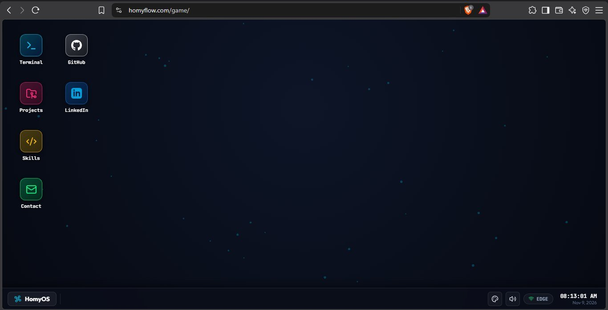
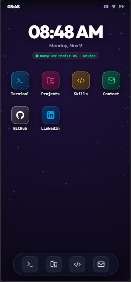

# Web OS Portfolio Template

A browser-based operating system interface and interactive developer portfolio. Provides a multi-window desktop environment for large screens and an adaptive smartphone home screen interface for mobile viewports.

## Project Overview

This repository contains a standalone, client-side web desktop application built entirely with vanilla JavaScript, modern CSS, and HTML5. It serves as an open-source template for engineers seeking an interactive alternative to traditional static portfolio websites.

The interface simulates an operating system environment featuring draggable and resizable windows, an interactive CLI shell with command evaluation, customizable color palettes, a synthetic Web Audio sound generator, and responsive viewport reconfiguration.

## Interface Preview

| Desktop Environment | Mobile Viewport |
| :---: | :---: |
|  |  |

## Core Architecture

The codebase follows an unbundled, modular architecture organized across four core files:

1. `index.html`: Defines the structural layout including the desktop viewport, canvas background layers, status bar, desktop icon grid, start menu, taskbar, and audio trigger bindings.
2. `style.css`: Implements design tokens via CSS custom properties, glassmorphism filters, window layout constraints, desktop icon flex wrapping, taskbar positioning, and responsive breakpoint rules (`@media (max-width: 768px)`).
3. `os.js`: Contains the desktop window manager (`OSWindow`), application lifecycle registry (`APP_REGISTRY`), procedural Web Audio API synthesizer (`SoundEffects`), canvas background renderer, and responsive event adapters.
4. `terminal.js`: Implements an interactive terminal subsystem (`WebTerminal`) featuring command dispatch, asynchronous task execution simulation, input history buffers, tab autocompletion, and console streaming.

### Subsystem Details

- **Window Management Subsystem**: The `OSWindow` class instantiates independent window instances inside `#windows-layer`. It attaches pointer listeners to window titlebars to compute delta movements, clamps window coordinates to viewport boundaries, manages hierarchical z-index focus stacking, and synchronizes minimize/restore states with taskbar tabs.
- **Responsive Layout Adapter**: When the viewport width drops below 768px, drag and resize listeners are disabled to prevent collision with touch gestures. Desktop windows switch to full-screen viewports (`100vw` by `100vh`), taskbars are hidden, and a native mobile layout activates containing a top status bar, digital clock widget, touch app grid, and bottom dock.
- **Audio Synthesizer Engine**: The `SoundEffects` class uses the browser Web Audio API (`AudioContext`) to generate click, drag, execution, and error sound effects procedurally using oscillators and gain envelopes. No external audio files or third-party audio libraries are required.
- **Canvas Rendering**: An interactive particle grid and an optional Matrix digital rain overlay render directly on HTML5 2D canvas contexts through `requestAnimationFrame` loops.

## Features

- **Multi-Window Desktop Environment**: Support for multiple concurrent windows with independent dragging, resizing, minimizing, maximizing, and stacking.
- **Interactive Command-Line Terminal**: Functional terminal interface with history navigation (up/down arrow keys), autocompletion (tab key), built-in commands (`help`, `neofetch`, `crawler`, `arch`, `projects`, `skills`, `contact`, `clear`), and simulated asynchronous worker streaming.
- **Adaptive Mobile Smartphone Interface**: Automatic viewport adaptation below 768px displaying a mobile status bar, lock-screen widget, 4-column application grid, full-screen application views, and a gesture home indicator.
- **Theming Subsystem**: Four switchable color themes (Cyberpunk, Matrix, Dracula, Amber CRT) configured through scoped CSS variables.
- **Zero Asset Dependencies**: Uses Lucide icons and web fonts delivered via CDN, paired with procedural audio and canvas graphics.

## Tech Stack

- **Markup**: HTML5 Semantic Elements, HTML5 Canvas API
- **Styling**: Vanilla CSS3, CSS Custom Properties, CSS Grid, Flexbox, Backdrop Filter API
- **Scripting**: Vanilla ECMAScript 2020+ (ES6 Modules/IIFE pattern)
- **Audio**: Web Audio API (`AudioContext`, `OscillatorNode`, `GainNode`)
- **Icons**: Lucide Icons (CDN distribution)
- **Typography**: Google Fonts (JetBrains Mono, Outfit)

## Local Setup

### Prerequisites

A local web server capable of serving static files (HTTP). Browsers require an HTTP/HTTPS context to initialize Web Audio and canvas contexts without CORS restrictions.

### Installation

Clone the repository:

```bash
git clone https://github.com/developer-username/web-os-portfolio.git
cd web-os-portfolio
```

### Running Locally

Use any of the following standard utilities to start a local static server:

Using Python 3:

```bash
python -m http.server 8080
```

Using Node.js:

```bash
npx serve .
```

Using PHP:

```bash
php -S localhost:8080
```

Navigate to `http://localhost:8080` in any modern web browser.

### Configuration

To customize portfolio content with your own information:

1. **User Profile and Contact Info**: Open `terminal.js` and modify the `PORTFOLIO_SPECS` object. Open `os.js` and update the `contact` application render block.
2. **Project Entries**: Open `os.js`, locate `APP_REGISTRY.projects`, and update project titles, descriptions, metrics, and technology tags within the markup template.
3. **Skills Matrix**: Open `os.js`, locate `APP_REGISTRY.skills`, and update the competency categories, labels, and percentage meters.
4. **Desktop Shortcuts and Metadata**: Open `index.html` to modify page `<title>`, meta tags, external links, and the Start Menu user profile header.
